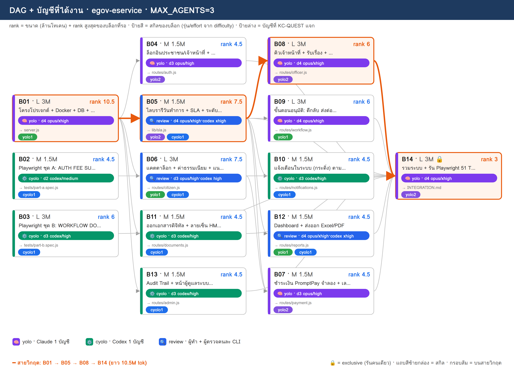
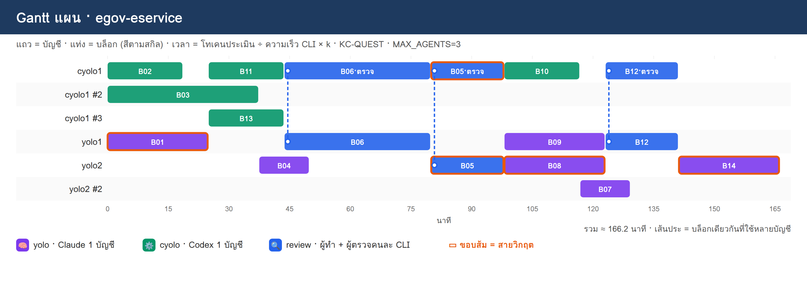

# PLAN · egov-eservice

**โจทย์:** สร้างเว็บ e-Service กลางของเทศบาลนครก็อตแทมตามชุดโจทย์ใน /workspace/egov-brief (อ่าน README.md ก่อน) ต้องทำตาม REQUIREMENTS.md CONTRACT.md TEST-DATA.md DECISIONS.md ครบทุกข้อ รันด้วย Docker Compose คำสั่งเดียว รองรับ TEST_MODE=1 และ BUG_MODE ตาม BUGS.md และมีชุด Playwright ครบทุก TC ใน TEST-PLAN.md (51 TC)

วางแผนเมื่อ 20/11/2026 17:36 · MAX_AGENTS 3 · บัญชี cyolo1, yolo1, yolo2 · ตัวปรับเวลา k (ยังไม่มี calib.json → k=1)

> แผนนี้ยังไม่ได้รันจริง — KC-QUEST เลือกบัญชีจากโควตา แล้วจำลองเวลาตาม dependency

## 1) โควตาของแต่ละบัญชี

| บัญชี | แพลน | ใช้ไป 5 ชม. | ใช้ไปสัปดาห์ | headroom | รีเซ็ต/หมดอายุ (ชม.) | U | slot | ที่มา |
|---|---|---|---|---|---|---|---|---|
| cyolo1 | plus | 0% | 0% | **100%** | 160.4 | 0.13 | 3 | team.py quota |
| yolo1 | default | 13% | 35% | **65%** | 42.4 | 0.362 | 3 | team.py quota |
| yolo2 | default | 13% | 35% | **65%** | 42.4 | 0.362 | 3 | team.py quota |

## 2) DAG + สกิล + บัญชี

**สายวิกฤต:** B01 → B05 → B08 → B14 · ยาว 10.5M tok

## 3) ตารางแจกงาน (เหตุผล KC-QUEST ทุกบล็อก)

| บล็อก | สกิล | ชื่อ | ขนาด · c | รอ | rank | บัญชี (บทบาท) | เริ่ม–จบ (นาที) | เหตุผล KC-QUEST |
|---|---|---|---|---|---|---|---|---|
| **B01** | 🧠 yolo | โครงโปรเจกต์ + Docker + DB + test hook | L · 3 | – | 10.5 | yolo1 (ทำ) | 0.0–25.0 | ทำ: yolo1 41.6 (U=0.361 F=0.015 S=0.792 S=1.0 L=0.0) · 3.00M ≈ 5ชม. 7.8% / สัปดาห์ 0.98% · อันดับ 2 yolo2 41.6 |
| B03 | ⚙️ cyolo | Playwright ชุด B: WORKFLOW DOC PDPA DASH AUDIT RBAC NFR | L · 3 | – | 6 | cyolo1 (ทำ) | 0.0–37.5 | ทำ: cyolo1 25.2 (U=0.13 F=0.01 S=0.922 S=0.4 L=0.0) · 3.00M ≈ 5ชม. 7.8% / สัปดาห์ 0.98% |
| B02 | ⚙️ cyolo | Playwright ชุด A: AUTH FEE SUBMIT UPLOAD PAY QUEUE SLA NOTI | M · 1.5 | – | 4.5 | cyolo1 (ทำ) | 0.0–18.8 | ทำ: cyolo1 19.7 (U=0.13 F=0.005 S=0.883 S=0.3 L=0.333) · 1.50M ≈ 5ชม. 3.9% / สัปดาห์ 0.49% |
| B11 | ⚙️ cyolo | ออกเอกสารดิจิทัล + ลายเซ็น HMAC + หน้า /verify | M · 1.5 | B01 | 4.5 | cyolo1 (ทำ) | 25.0–43.8 | ทำ: cyolo1 19.1 (U=0.13 F=0.005 S=0.844 S=0.3 L=0.333) · 1.50M ≈ 5ชม. 3.9% / สัปดาห์ 0.49% |
| B13 | ⚙️ cyolo | Audit Trail + หน้าผู้ดูแลระบบ (บริการ วันหยุด ผู้ใช้) | M · 1.5 | B01 | 4.5 | cyolo1 (ทำ) | 25.0–43.8 | ทำ: cyolo1 15.2 (U=0.13 F=0.005 S=0.805 S=0.3 L=0.667) · 1.50M ≈ 5ชม. 3.9% / สัปดาห์ 0.49% |
| B04 | 🧠 yolo | ล็อกอินประชาชน/เจ้าหน้าที่ + ลงทะเบียน + OTP lock | M · 1.5 | B01 | 4.5 | yolo2 (ทำ) | 37.5–50.0 | ทำ: yolo2 33.5 (U=0.361 F=0.008 S=0.831 S=0.429 L=0.0) · 1.50M ≈ 5ชม. 3.9% / สัปดาห์ 0.49% · อันดับ 2 yolo1 32.3 |
| B06 | 🔍 review | แคตตาล็อก + ค่าธรรมเนียม + แนบไฟล์ + ร่าง + หน้าคำขอประชาชน | L · 3 | B01 | 7.5 | yolo1 (ทำ), cyolo1 (ตรวจ) | 43.8–80.0 | ทำ: yolo1 36.2 (U=0.361 F=0.015 S=0.714 S=0.714 L=0.0) · 3.00M ≈ 5ชม. 7.8% / สัปดาห์ 0.98% · อันดับ 2 yolo2 33.4   ตรวจ: cyolo1 24.5 (U=0.13 F=0.003 S=0.782 S=0.5 L=0.0) · 0.90M ≈ 5ชม. 2.34% / สัปดาห์ 0.29% |
| **B05** | 🔍 review | ไลบรารีวันทำการ + SLA + ระดับเตือน | M · 1.5 | B01 | 7.5 | yolo2 (ทำ), cyolo1 (ตรวจ) | 80.0–98.1 | ทำ: yolo2 37.2 (U=0.361 F=0.008 S=0.792 S=0.714 L=0.0) · 1.50M ≈ 5ชม. 3.9% / สัปดาห์ 0.49% · อันดับ 2 yolo1 35.4   ตรวจ: cyolo1 24.3 (U=0.13 F=0.002 S=0.77 S=0.5 L=0.0) · 0.45M ≈ 5ชม. 1.17% / สัปดาห์ 0.15% |
| **B08** | 🧠 yolo | คิวเจ้าหน้าที่ + รับเรื่อง + รายละเอียด + แสดงเลขเต็ม + ไฟล์แนบ | L · 3 | B05 | 6 | yolo2 (ทำ) | 98.1–123.1 | ทำ: yolo2 34.0 (U=0.361 F=0.015 S=0.714 S=0.571 L=0.0) · 3.00M ≈ 5ชม. 7.8% / สัปดาห์ 0.98% · อันดับ 2 yolo1 32.8 |
| B09 | 🧠 yolo | ขั้นตอนอนุมัติ: ตีกลับ ส่งต่อ อนุมัติ ส่งแก้ ยกเลิกอัตโนมัติ | L · 3 | B05 | 6 | yolo1 (ทำ) | 98.1–123.1 | ทำ: yolo1 32.8 (U=0.361 F=0.015 S=0.636 S=0.571 L=0.0) · 3.00M ≈ 5ชม. 7.8% / สัปดาห์ 0.98% · อันดับ 2 yolo2 29.5 |
| B10 | ⚙️ cyolo | แจ้งเตือนในระบบ (กระดิ่ง) ตามระดับ SLA | M · 1.5 | B05 | 4.5 | cyolo1 (ทำ) | 98.1–116.9 | ทำ: cyolo1 20.8 (U=0.13 F=0.005 S=0.731 S=0.3 L=0.0) · 1.50M ≈ 5ชม. 3.9% / สัปดาห์ 0.49% |
| B07 | 🧠 yolo | ชำระเงิน PromptPay จำลอง + เลขคำขอ + ใบเสร็จ | M · 1.5 | B05, B06 | 4.5 | yolo2 (ทำ) | 116.9–129.4 | ทำ: yolo2 27.8 (U=0.361 F=0.008 S=0.675 S=0.429 L=0.333) · 1.50M ≈ 5ชม. 3.9% / สัปดาห์ 0.49% · อันดับ 2 yolo1 26.7 |
| B12 | 🔍 review | Dashboard + ส่งออก Excel/PDF | M · 1.5 | B05 | 4.5 | yolo1 (ทำ), cyolo1 (ตรวจ) | 123.1–141.2 | ทำ: yolo1 30.0 (U=0.361 F=0.008 S=0.597 S=0.429 L=0.0) · 1.50M ≈ 5ชม. 3.9% / สัปดาห์ 0.49% · อันดับ 2 yolo2 27.2   ตรวจ: cyolo1 20.5 (U=0.13 F=0.002 S=0.719 S=0.3 L=0.0) · 0.45M ≈ 5ชม. 1.17% / สัปดาห์ 0.15% |
| **B14** | 🧠 yolo | รวมระบบ + รัน Playwright 51 TC + BUG_MODE B01–B12 | L · 3 | B02, B03, B04, B05, B06, B07, B08, B09, B10, B11, B12, B13 | 3 | yolo2 (ทำ) | 141.2–166.2 | ทำ: yolo2 28.0 (U=0.361 F=0.016 S=0.597 S=0.286 L=0.0) · 3.00M ≈ 5ชม. 7.8% / สัปดาห์ 0.98% · อันดับ 2 yolo1 26.8 |

## 4) Gantt แผน

## 5) รอบแจกงาน

| นาทีที่ | บล็อกที่เริ่ม |
|---|---|
| 0 | B03→cyolo1, B02→cyolo1, B01→yolo1 |
| 25 | B11→cyolo1, B13→cyolo1 |
| 37.5 | B04→yolo2 |
| 43.8 | B06→yolo1+cyolo1 |
| 80 | B05→yolo2+cyolo1 |
| 98.1 | B10→cyolo1, B08→yolo2, B09→yolo1 |
| 116.9 | B07→yolo2 |
| 123.1 | B12→yolo1+cyolo1 |
| 141.2 | B14→yolo2 |

## 6) สรุป

- บล็อก 14 · แจกได้ 14 · agent พร้อมกันสูงสุด 3/3
- เวลาประมาณ 166.2 นาที (แท่ง Gantt) · ไฟล์ผลของทีม: `/workspace/plans/egov-eservice/app/`

ต่อไป: `dagplan.py export egov-eservice` → `dagplan.py run egov-eservice` → `dagplan.py report egov-eservice`
