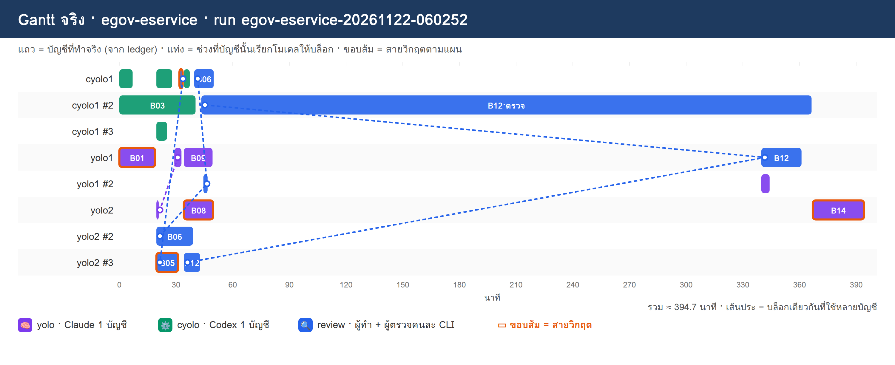
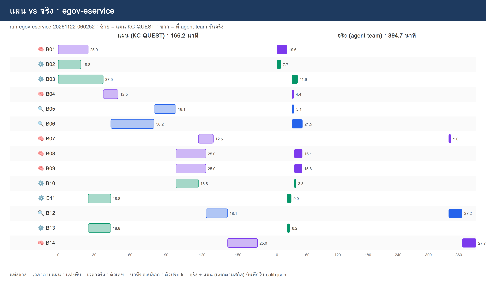

# REPORT · egov-eservice

**run:** `egov-eservice-20261122-060252` · `/workspace/.agent-team/egov-eservice-20261122-060252` · โจทย์: สร้างเว็บ e-Service กลางของเทศบาลนครก็อตแทมตามชุดโจทย์ใน /workspace/egov-brief (อ่าน README.md ก่อน) ต้องทำตาม REQUIREMENTS.md CONTRACT.md TEST-DATA.md DECISIONS.md ครบทุกข้อ รันด้วย Docker Compose คำสั่งเดียว รองรับ TEST_MODE=1 และ BUG_MODE ตาม BUGS.md และมีชุด Playwright ครบทุก TC ใน TEST-PLAN.md (51 TC)

## ตารางบล็อก (แผน vs จริง)

| บล็อก | สกิล | บัญชีแผน | บัญชีจริง | นาทีแผน | นาทีจริง | tokens (ไม่รวม cache read) | ครั้ง | สถานะ | ไฟล์ผล |
|---|---|---|---|---|---|---|---|---|---|
| **B01** | 🧠 yolo | yolo1(ทำ) | yolo1(ทำ) | 25.00 | 19.60 | 372,620 | 1 | ok | ✅ server.js |
| B02 | ⚙️ cyolo | cyolo1(ทำ) | cyolo1(ทำ) | 18.75 | 7.67 | 103,247 | 1 | ok | ✅ tests/part-a.spec.js |
| B03 | ⚙️ cyolo | cyolo1(ทำ) | cyolo1(ทำ) | 37.50 | 11.88 | 142,675 | 2 | ok | ✅ tests/part-b.spec.js |
| B04 | 🧠 yolo | yolo2(ทำ) | yolo2(ทำ), yolo1(ทำ) | 12.50 | 4.43 | 202,102 | 2 | ok | ✅ routes/auth.js |
| **B05** | 🔍 review | yolo2(ทำ), cyolo1(ตรวจ) | yolo2(ทำ), cyolo1(ตรวจ) | 18.12 | 5.05 | 215,518 | 3 | ok | ✅ lib/sla.js |
| B06 | 🔍 review | yolo1(ทำ), cyolo1(ตรวจ) | yolo2(ทำ), cyolo1(ตรวจ), yolo1(ทำ) | 36.25 | 21.50 | 623,040 | 5 | ok | ✅ routes/citizen.js |
| B07 | 🧠 yolo | yolo2(ทำ) | yolo1(ทำ) | 12.50 | 5.03 | 114,208 | 1 | ok | ✅ routes/payment.js |
| **B08** | 🧠 yolo | yolo2(ทำ) | yolo2(ทำ) | 25.00 | 16.13 | 332,944 | 1 | ok | ✅ routes/officer.js |
| B09 | 🧠 yolo | yolo1(ทำ) | yolo1(ทำ) | 25.00 | 15.82 | 309,202 | 1 | ok | ✅ routes/workflow.js |
| B10 | ⚙️ cyolo | cyolo1(ทำ) | cyolo1(ทำ) | 18.75 | 3.75 | 60,028 | 1 | ok | ✅ routes/notifications.js |
| B11 | ⚙️ cyolo | cyolo1(ทำ) | cyolo1(ทำ) | 18.75 | 8.98 | 116,436 | 1 | ok | ✅ routes/documents.js |
| B12 | 🔍 review | yolo1(ทำ), cyolo1(ตรวจ) | yolo2(ทำ), cyolo1(ตรวจ), yolo1(ทำ) | 18.13 | 27.23 | 728,610 | 6 | ok | ✅ routes/reports.js |
| B13 | ⚙️ cyolo | cyolo1(ทำ) | cyolo1(ทำ) | 18.75 | 6.25 | 100,950 | 1 | ok | ✅ routes/admin.js |
| **B14** | 🧠 yolo | yolo2(ทำ) | yolo2(ทำ) | 25.00 | 27.72 | 241,211 | 1 | ok | ✅ INTEGRATION.md |

- tokens รวมของบล็อก **3,662,791** = ผลรวมจาก ledger ของ run (27 การเรียก) **3,662,791** ✅ ตรงกัน
- การเรียกที่ไม่ใช่บล็อก (ตรวจความพร้อม ฯลฯ): 0 ครั้ง · 0 tokens (ไม่นับในตาราง)
- เวลารวม: แผน 166.2 นาที · จริง 394.7 นาที
- บล็อกเสร็จ 14/14

## ภาพ

## ความต่างระหว่างแผนกับของจริง

- B04: แผน yolo2(ทำ) → จริง yolo2(ทำ), yolo1(ทำ)
- B06: แผน yolo1(ทำ), cyolo1(ตรวจ) → จริง yolo2(ทำ), cyolo1(ตรวจ), yolo1(ทำ)
- B07: แผน yolo2(ทำ) → จริง yolo1(ทำ)
- B12: แผน yolo1(ทำ), cyolo1(ตรวจ) → จริง yolo2(ทำ), cyolo1(ตรวจ), yolo1(ทำ)
- (export ส่งเป็นฝั่ง yolo/cyolo ไม่ผูกบัญชี เพื่อให้ failover ของ agent-team ทำงาน → agent-team เลือกบัญชีในฝั่งเองตามโหลด/โควตา ดู references/run.md)
- event worker_stop:  → โควตา 93% ≥ เกณฑ์ 80%
- event worker_switch: B08 yolo1→yolo2 บัญชี yolo1 หยุดรับงาน: โควตา 93% ≥ เกณฑ์ 80%
- event worker_switch: B07 yolo1→yolo2 บัญชี yolo1 หยุดรับงาน: โควตา 93% ≥ เกณฑ์ 80%
- event worker_stop:  → โควตา 99% ≥ เกณฑ์ 80%
- event worker_switch: B08 yolo2→ บัญชี yolo2 หยุดรับงาน: โควตา 99% ≥ เกณฑ์ 80%
- event worker_switch: B09 yolo2→ บัญชี yolo2 หยุดรับงาน: โควตา 99% ≥ เกณฑ์ 80%
- event worker_switch: B07 yolo2→ บัญชี yolo2 หยุดรับงาน: โควตา 99% ≥ เกณฑ์ 80%
- event worker_stop:  → โควตา 82% ≥ เกณฑ์ 80%
- event worker_switch: B07 yolo2→yolo1 บัญชี yolo2 หยุดรับงาน: โควตา 82% ≥ เกณฑ์ 80%
- event worker_stop:  → โควตา 92% ≥ เกณฑ์ 80%
- event worker_switch: B07 yolo1→ บัญชี yolo1 หยุดรับงาน: โควตา 92% ≥ เกณฑ์ 80%
- event worker_switch: B14 yolo1→ บัญชี yolo1 หยุดรับงาน: โควตา 92% ≥ เกณฑ์ 80%

## ตัวปรับเวลา k (calib.json)

`/workspace/plans/calib.json`: {"yolo": 0.7098, "cyolo": 0.3425, "review": 0.7418}

k = นาทีจริง ÷ นาทีแผน (ก่อนคูณ k) แยกตามสกิล · `plan` ครั้งถัดไปคูณเวลาแต่ละบล็อกด้วย k ของสกิลนั้น
